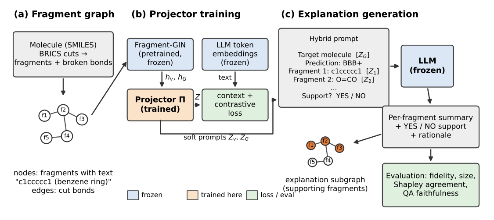

# Fragments to Narratives: GSPELL for Molecular Property Prediction

CSC 8851 Deep Learning (Fall 2026) course project.

This project adapts **GSPELL** ([Baghershahi et al., 2026](https://arxiv.org/abs/2508.07117)), an LLM-based explainer for graph neural networks, from node classification on text-attributed graphs to **graph-level** explanation of molecules. Each molecule is split into BRICS fragments; the fragments become graph nodes carrying text (fragment SMILES and functional groups), so every molecule is a small text-attributed graph. A GIN trained on these fragment graphs is explained by a frozen Llama-3.1-8B-Instruct that receives the GIN's embeddings as soft prompts.
Later on, other interpretability methods, such as SHAP and GradCAM were examined. Future work could be to extend this to hypergraph neural network approaches. The motivation behind this project is to examine the reasoning behind predictions given by GNN, ML, deep learning, and other AI models used to predict molecular properties such as toxicity, blood-brain barrier penetration, and more. It is crucial to know the reasoning behind these predictions in order to ensure that models are trustworthy and reflective of reality.



## Setup

Needs Python 3.10+ and an NVIDIA GPU (CUDA). Used Google Colab with an L4 GPU.

```bash
pip install -r requirements.txt
# or: conda env create -f environment.yml && conda activate frag-gspell
```

Explanations use `meta-llama/Llama-3.1-8B-Instruct`, which is gated on Hugging Face: request access on the model page (approval is usually within 24 hours), then

```bash
export HF_TOKEN=hf_...
```

## Reproduce

```bash
python prepare_data.py   # download BBBP/BACE/ESOL, scaffold split 80/10/10, build fragment graphs, write fragment_stats.csv
python train_gin.py      # fragment-graph GIN, 3 seeds per dataset -> gin_results.csv, checkpoints/
python run_gspell.py --dataset BBBP --n_eval 30   # explanations + fidelity/size vs. baselines -> gspell_BBBP_summary.csv
                                                  # also BACE, or ESOL (regression: classed at the training median)
```

`prepare_data.py --data_dir <folder>` uses CSVs you already have instead of downloading.

**Ionic mode.** Add `--ionic` to `prepare_data.py`, `train_gin.py` and `run_gspell.py` to keep counter-ions as graph nodes instead of removing them (outputs go to `frag_graphs_ions/` and `checkpoints_ions/`, so both modes can be compared).

The same steps are available as Colab notebooks in `notebooks/`. **`run_all.ipynb` does everything in one session** (data → models → diagnostics → LLM explanations → tables → figures → export), skipping anything already done, so it can simply be rerun after a disconnect. The individual notebooks below are the same stages split up:

| Notebook | What it does |
|---|---|
| `run_all.ipynb` | all stages for both modes in one session; resumable; writes `results/latex_rows.txt` and a zip export |
| `prelim_report_pipeline.ipynb` | fragment graphs, statistics table, fragment histogram, GIN training |
| `gspell_bbbp.ipynb` | projector training, GSPELL explanations on BBBP, comparison with GNNExplainer |
| `ionic_mode.ipynb` | builds BRICS + ionic graphs, compares statistics and GIN results with the default mode |
| `diagnostics.ipynb` | both modes: confusion matrices (classification), parity plots (regression), t-SNE/UMAP of molecule and fragment embeddings, readout-attention maps; no LLM needed |
| `explain_more.ipynb` | BBBP, BACE and ESOL with more molecules; atom-GIN baseline; Grad-CAM (fragment and atom level) and readout attention; agreement analysis; RDKit drawings |

## Files

| File | Purpose |
|---|---|
| `fragment_graphs.py` | BRICS partition with atom mapping, fragment text and features, fragment edges, scaffold split |
| `functional_groups.py` | fragment labels: RDKit's curated functional-group list plus additions, ring names, Ertl's list-free group detection, and dataset-level group mining |
| `faithfulness.py` | exact fragment Shapley values, removal counterfactuals, deletion curves, agreement of each explainer with Shapley, and the QA faithfulness test (with vs. without soft prompts) |
| `frag_gin.py` | fragment-graph GIN (GINE layers, attention readout), training and evaluation |
| `gspell_mol.py` | projector, hybrid soft prompts, LLM explanations, fidelity, GNNExplainer and random baselines |
| `viz_mol.py` | confusion matrix, parity plot, t-SNE/UMAP, attention summaries and maps, explanation heatmaps, soft-prompt alignment plot |
| `cam_mol.py` | Grad-CAM on fragment and atom GINs, readout attention, atom-level GIN, agreement metrics, RDKit drawings |
| `prepare_data.py`, `train_gin.py`, `run_gspell.py` | command-line entry points |

## Method summary

- **Fragment graph.** BRICS bonds are cut (`FindBRICSBonds` + `FragmentOnBonds`), keeping duplicate fragments and the atom-to-fragment map. Nodes are fragments; edges are the cut bonds (bond type + conjugation). Node features: 512-bit Morgan fingerprint centered on the fragment's atoms plus 11 atom-level descriptor sums (Crippen logP/MR, TPSA, heteroatom counts, aromatic fraction, ...). Counter-ions are removed; molecules with no BRICS bonds become single-node graphs.
- **Ionic mode (optional).** Every component of the SMILES is kept; metal-heteroatom bonds written as covalent are split into ions (RDKit `MetalDisconnector`). BRICS cuts are made only in the parent molecule (the largest component that is not a known counter-ion); each counter-ion or salt partner is one named node. Each counter-ion is joined by an ionic edge to the fragments of opposite formal charge, or, for neutral partners such as `.Cl` in an HCl salt, to the fragment holding the most basic nitrogen. Extra features: net formal charge and a counter-ion flag on nodes, an ionic flag on edges.
- **GIN.** MLP compression of fragment features, 3 GINE layers with residual connections, attention readout, 3 seeds, early stopping on validation.
- **GSPELL, graph-level.** Projector Π maps each fragment embedding and the molecule embedding to k = 5 soft tokens, trained with GSPELL's context-alignment and contrastive losses. The prompt lists the molecule's soft prompt, the GIN prediction, and every fragment's text followed by its soft prompt; the LLM returns YES/NO support per fragment. YES fragments form the explanation subgraph.
- **Faithfulness (the project's contribution).** Exact fragment-level Shapley values (all 2^n fragment subsets, n ≤ 12) on the GIN's output oriented toward the predicted class, checked by the efficiency axiom; single-fragment removal counterfactuals from the same table; deletion curves for every explainer's ranking; and a QA test whose answers come from the model, asked to the LLM with and without the soft prompts.
- **Evaluation.** Fidelity (GIN gives the same class on the explanation subgraph; for ESOL, the same side of the training median) and explanation size, against GNNExplainer (threshold and size-matched), a text-only LLM without soft prompts, Grad-CAM on the fragment GIN, readout attention, Grad-CAM on an atom-level GIN summed over fragments, and a random half-of-fragments baseline. CAM-family explainers keep the same number of fragments as GSPELL.

## Acknowledgements

GSPELL design follows the original paper and [code](https://github.com/pbaghershahi/GSPELL). Datasets: MoleculeNet (Wu et al., 2018).
